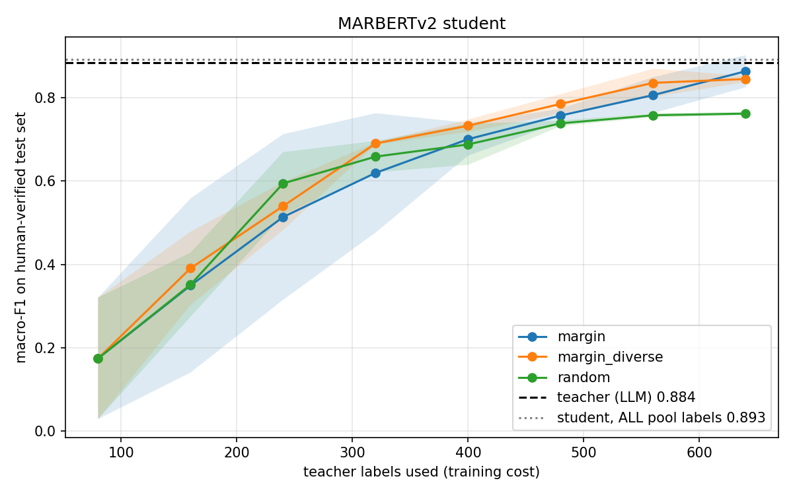

# Offline Arabic Customer-Message Routing with Active Distillation

**Challenge 2 · Deliver AI with Less Compute** — Future AI Builders Hackathon (HUMAIN)

> *"My laptop couldn't run AI — so I built AI that runs on it, and made it cheaper to build too."*

A large LLM (**teacher**) routes Saudi customer messages to 8 departments very well — but needs a GPU/API, internet, and money for every message. We distill it into a small Arabic model (**student**) that runs **offline on a CPU**. The twist: the student chooses which messages are worth paying the teacher for (**active distillation**), so it's cheaper to **run** *and* cheaper to **train**.

## Results
_Filled from `experiments/RESULTS.md`._

| | Teacher (LLM API) | Student (ours, CPU, offline) |
|---|---|---|
| macro-F1 (human-verified test) | | |
| Latency per message | | |
| Needs GPU / internet | yes | **no** |
| Teacher labels used for training | — | __ / __ pool messages |



## How it works
1. **Data** — a generator LLM writes realistic messages in Najdi, Hijazi, Eastern and MSA (pool + held-out test), plus stress sets: unseen dialects (Egyptian, Levantine), natural Arabizi, Arabic–English code-switching.
2. **Teacher** — Gemini labels messages (forced choice of 8 departments, temperature 0, batched, cached).
3. **Human verification** — every test message where the generator and the teacher disagree is checked by hand (+ random spot-checks).
4. **Active distillation** — seed 80 labels → train student → pick the 80 messages it's least sure about (margin, + diversity clustering) → teacher labels only those → repeat to a 640-label budget. Compared against random selection, 3 seeds each.
5. **Student** — MARBERTv2 fine-tuned for classification, int8-quantized for CPU.
6. **Robustness** — stress sets + perturbations (typos, letter variants, Arabizi, truncation, emojis), then zero-cost augmentation to fix weak spots.

## Reproduce
**Colab (T4 GPU):** open `notebooks/hackathon.ipynb`, add `GEMINI_API_KEY` (and `GH_TOKEN`) to Colab Secrets, run top to bottom. `MOCK = True` runs everything on fake data in ~2 minutes.

**Laptop (offline demo):**
```bash
pip install -r requirements-laptop.txt
# put the trained model in models/student_final (from Google Drive)
python bench_laptop.py   # real CPU numbers
python app.py            # turn Wi-Fi off, open http://127.0.0.1:7860
```

## Repository
```
notebooks/hackathon.ipynb   the full pipeline, step by step
src/labels.py               8 departments (single source of truth)
src/llm.py                  Gemini wrapper: pacing, retries, JSON output
src/generate.py             synthetic data, dedup/leak removal, human review
src/teacher.py              batched, cached teacher labels
src/students.py             TF-IDF baseline + MARBERTv2 student
src/active.py               selection strategies + active distillation loop
src/evaluation.py           macro-F1, bootstrap CI, run log
src/robustness.py           perturbations + augmentation
src/deploy.py               int8 quantization + CPU benchmark
src/report.py               curves, savings table, RESULTS.md
app.py · bench_laptop.py    offline demo + laptop benchmark
docs/DECISIONS.md           technical decisions & trade-offs
```

## Limitations
Synthetic data (mitigated: separate generator, human-verified test, stress sets) · the student inherits teacher mistakes · one label per message · limited dialect coverage.
**Next:** optional online cascade (escalate low-confidence messages to ALLaM when connected), confidence calibration, urgency label, real anonymized data.
